# SHARDEV — Backlog técnico ESTRUCTURA BASE

> Plataforma API modular sobre Laravel. Core reutilizable + `packages/` sobre Laravel estándar.
> Reglas madre:
> 1. **REST y GraphQL son adapters. Core/Application no saben quién llama.**
> 2. **Repository = frontera de acceso autorizado a un Resource (auth + validación + query constraints + lifecycle antes de persistencia). No existe porque exista un Model.**
>
> Alcance: SOLO estructura base + `Product` como demo. NO implementar Catalog/Orders/Billing/Notifications ni ningún otro módulo de negocio.

## Convenciones

- Formato por tarea: ID / Fase / Título / Descripción / Dependencias / Criterio de aceptación / Estimación.
- Fases permitidas: `Core | Application | Repository | REST | GraphQL | Config | Testing | Docs | Security | Etc`
- Fases de seguridad (solo fase CASA): `AST | Auth | Data | Infra | Logs`. `Infra` = control del proveedor cloud/deploy, entregado como requisito + evidencia, no como código del framework.
- Estimación: `S` (<4h) / `M` (1–3 días) / `L` (3–5 días). Incluye código + tests mínimos de la tarea.
- Orden de implementación normativo: § Implementation order (1–18) del documento de visión.
- Constraints vinculantes: § Important constraints + § Architecture tests (ver `backlog/00-index.md`).
- Entrada/salida: REST y GraphQL NUNCA acceden a Eloquent directo, NUNCA autorizan en controllers/resolvers, NUNCA duplican validación. Todo pasa por el mismo Use Case + mismo Repository.

## Índice de archivos (legibles por IA)

- `BACKLOG.md` — este archivo (listado completo).
- `backlog/00-index.md` — reglas de ejecución para agentes IA, orden, definition of done.
- `backlog/fase-etc-platform.md` — T-001…T-005 (scaffolding, CLI, doctor).
- `backlog/fase-core.md` — T-010…T-014 (contratos, contexto, acciones, errores, ApiResponse).
- `backlog/fase-repository.md` — T-020…T-022, T-030…T-032, T-040…T-042, T-050…T-053 (resource, auth, query, lifecycle, persistencia).
- `backlog/fase-application.md` — T-060…T-061, T-090…T-091 (use cases Product, auth/context builders).
- `backlog/fase-rest.md` — T-070…T-072.
- `backlog/fase-graphql.md` — T-073…T-074.
- `backlog/fase-config.md` — T-080…T-081.
- `backlog/fase-testing.md` — T-100…T-102, T-110…T-111.
- `backlog/fase-docs.md` — T-120…T-122.
- `backlog/fase-casa.md` — T-CASA-001…T-CASA-030 (hardening y preparación para evaluación de seguridad externa).
- `backlog/dependencias.md` — diagrama Mermaid + ASCII + orden topológico sugerido.
- `AGENTS.md` — instrucciones para OpenCode/agentes.
- `CLAUDE.md` — instrucciones para Claude.

---

## FASE Etc (Platform / Scaffolding / DX) — base Laravel + packages/

### T-001 — Etc — Estructura `packages/` + autoload + discovery

- **Descripción:** Crear `packages/` en proyecto generado sin alterar estructura estándar Laravel. Definir estrategia namespaces (`Packages\<Nombre>\` o equivalente), `composer.json` autoload PSR-4, manifest `extra.platform.provider`, y registro automático de ServiceProviders. `composer dump-autoload` automatizable.
- **Dependencias:** — (raíz)
- **Criterio de aceptación:** `platform new demo` genera app Laravel estándar + `packages/` con stubs oficiales; `composer dump-autoload` pasa; `php artisan` sigue funcionando sin flags del framework; test verifica que `App\` y `Packages\` no colisionan.
- **Estimación:** M

### T-002 — Etc — `config/platform.php` + `.env.example` sqlite-first

- **Descripción:** Agregar solo `config/platform.php` (`version`, `api.rest`, `api.graphql`) sin duplicar config Laravel. `.env.example` con `APP_*`, `PLATFORM_VERSION`, `API_REST_ENABLED`, `API_GRAPHQL_ENABLED`, `DB_CONNECTION=sqlite`.
- **Dependencias:** T-001
- **Criterio de aceptación:** `config('platform.api.rest')` lee env; proyecto arranca con sqlite sin MySQL/PG; `php artisan config:show platform` ok.
- **Estimación:** S

### T-003 — Etc — CLI `platform new --laravel=` + matriz compatibilidad

- **Descripción:** CLI con `platform new my-project [--laravel=12|--laravel=12.61|--laravel="^12.0"|interactivo]`. Valida contra matriz soportada (Framework 1.x → Laravel `^12.0`, PHP `^8.4`). Flujo 15 pasos de la visión (validar nombre → crear Laravel → instalar packages oficiales → autoload → providers → config → .env → migrate → seed demo → dump-autoload → checks). Soporta modo no-interactivo por flags.
- **Dependencias:** T-001, T-002
- **Criterio de aceptación:** `platform new demo --laravel=12 --no-interaction` crea proyecto instalable; versión incompatible (ej. `--laravel=9`) falla con mensaje; e2e smoke `php artisan serve` responde.
- **Estimación:** L

### T-004 — Etc — CLI `platform package make/list` + manifest

- **Descripción:** `platform package make <nombre>` crea `packages/<nombre>/` con estructura mínima ampliable (ServiceProvider, config, routes, migrations, tests vacíos). `platform package:list` lista oficiales + usuario. Sin lógica de negocio en providers.
- **Dependencias:** T-001
- **Criterio de aceptación:** `platform package make catalog --dry-run` muestra árbol esperado; tras crear, provider se auto-registra y `package:list` lo muestra; test de `catalog` de ejemplo NO se implementa como negocio (solo scaffold de prueba efímera).
- **Estimación:** M

### T-005 — Etc — Comando `platform doctor`

- **Descripción:** Checks: PHP, Laravel, Composer, Framework version, packages instalados, env, DB, cache, queue, REST, GraphQL, autoload, providers. Salida estilo checklist visión §17.
- **Dependencias:** T-003, T-070, T-073
- **Criterio de aceptación:** En proyecto sano imprime 10× `✓` + `Application is ready.` y exit 0; con DB caída falla check DB con exit !=0 y mensaje accionable.
- **Estimación:** M

---

## FASE Core — contratos, contexto, acciones, errores, respuesta

### T-010 — Core — Contratos mínimos de frontera (justificados)

- **Descripción:** Crear SOLO interfaces que representen frontera real: `AuthorizationManager`, `ResourceRegistry`, `QueryExecutor`, `AuthenticationProvider`, `PermissionResolver`, `ConfigurationProvider`, `ResourceRepository` (contract). Cada una con docblock que justifica frontera. Prohibido interfaz-por-clase ceremonial.
- **Dependencias:** T-001
- **Criterio de aceptación:** `grep -r "Illuminate\\\\" packages/core/src/Contracts` retorna 0; cada contrato tiene test de existencia + doc de frontera; revisión arch T-110 los usa como referencia.
- **Estimación:** M

### T-011 — Core — `ApplicationContext` agnóstico al transporte

- **Descripción:** Value object inmutable: user, tenant, application, device, locale, timezone, permissions/capabilities, request_id, correlation_id. Sin dependencia HTTP. Factories separadas en T-091.
- **Dependencias:** T-010
- **Criterio de aceptación:** Se puede construir contexto desde array/CLI sin `Request`; test crea contexto con tenant != user_id; `request_id` auto-generado UUID si ausente.
- **Estimación:** M

### T-012 — Core — `ResourceAction` enum extensible

- **Descripción:** `enum ResourceAction: string { VIEW, CREATE, UPDATE, DELETE, RESTORE }` + mecanismo para acciones custom por módulo sin editar Core (ej. registry de acciones o enum extensible vía definición).
- **Dependencias:** T-010
- **Criterio de aceptación:** `ProductResourceDefinition` puede declarar acción extra sin modificar enum Core; test `ResourceAction::from('view')` ok y custom action resuelve permiso `products.<custom>`.
- **Estimación:** S

### T-013 — Core — Excepciones dominio/aplicación (sin HTTP)

- **Descripción:** `Unauthorized, Forbidden, ResourceNotFound, ValidationFailed, Conflict, BusinessRuleViolation, ResourceOperationNotSupported`. Nunca `HttpException` desde Core. Incluyen código interno + contexto seguro (sin filtrar SQL).
- **Dependencias:** T-010
- **Criterio de aceptación:** `grep -rn "HttpException\|abort(" packages/core/src` retorna 0; test lanza `ResourceNotFound` y verifica `getCode()`/payload sin trace SQL.
- **Estimación:** S

### T-014 — Core — Abstracción `ApiResponse / ApiError / ApiMeta / PaginationMeta`

- **Descripción:** Estructuras internas de resultado. REST las serializa a envelope `{status,code,message,data,meta}`; GraphQL usa mismas estructuras internas pero respeta convenciones GraphQL (no forzar envelope REST dentro de GraphQL).
- **Dependencias:** T-013
- **Criterio de aceptación:** Use Case retorna `ApiResponse`; adapter REST produce envelope exacto visión; adapter GraphQL produce error-spec GraphQL desde mismo objeto; test de ambos desde mismo `ApiResponse`.
- **Estimación:** S

---

## FASE Repository — resource, autorización, query, lifecycle, persistencia

### T-020 — Repository — `ResourceDefinition` ligera + metadatos separados

- **Descripción:** `name, actions[], filters[], includes[], sorting[], fields[], repositoryClass, policy`. No God class: metadatos (FilterDef/IncludeDef/SortDef) en clases separadas.
- **Dependencias:** T-012
- **Criterio de aceptación:** Definir recurso ficticio en test sin tocar DB; `getFilters()` retorna allow-list; intentar registrar campo no declarado falla en validación T-040.
- **Estimación:** M

### T-021 — Repository — `ResourceRegistry` + binding

- **Descripción:** `register/get/has/all`, singleton en container, error en duplicado, validación `repositoryClass` existe. Registro vía ServiceProviders.
- **Dependencias:** T-020
- **Criterio de aceptación:** Registrar `products` 2 veces lanza excepción; `has('products')===true`, `get('unknown')` lanza `ResourceNotFound` de dominio (no 404 HTTP).
- **Estimación:** S

### T-022 — Repository — `ProductResourceDefinition` demo (solo definición)

- **Descripción:** Recurso `products`: filters `sku,ean,brand_id,active`; includes/sorts/fields mínimos allow-listed. Sin modelo ni migración aquí.
- **Dependencias:** T-020
- **Criterio de aceptación:** Test `registry->get('products')->filters()` contiene exactamente los 4 filtros; include `brand` NO permitido salvo declarado.
- **Estimación:** S

### T-030 — Repository — `AuthorizationManager::authorize(resource, action, context)`

- **Descripción:** Punto centralizado. Repository pregunta `authorize('products', UPDATE, $ctx)`; no sabe cómo se almacenan permisos. Permiso derivado `{resource}.{action}`.
- **Dependencias:** T-011, T-012, T-021
- **Criterio de aceptación:** Test con contexto sin permiso `products.update` → `Forbidden`; con permiso → pasa; ningún `Gate::authorize` ni `if ($user->can…)` en controllers (verificado por T-110).
- **Estimación:** M

### T-031 — Repository — Adapter autorización inicial (intercambiable)

- **Descripción:** Implementación por defecto (Laravel Gate + config, preparada para Spatie/servicio externo/RBAC/ABAC vía `PermissionResolver`). Adapter en Infrastructure, no en Core.
- **Dependencias:** T-030
- **Criterio de aceptación:** Cambiar binding `PermissionResolver` en test cambia decisión sin tocar Repository; test con resolver in-memory otorga/deniega correctamente.
- **Estimación:** M

### T-032 — Repository — Scope contextual tenant/ownership (sin `user_id==tenant`)

- **Descripción:** `TenantScope` / `OwnershipScope` aplicados por Repository desde `ApplicationContext` (user, tenant, application separados). Opt-in por definición de recurso.
- **Dependencias:** T-030, T-011
- **Criterio de aceptación:** Test con 2 tenants: query como tenant A no retorna filas de tenant B; test documenta que `user_id` nunca se usa como tenant implícito.
- **Estimación:** M

### T-040 — Repository — Abstracciones Query (`QueryOptions`, `FilterSet`, `IncludeSet`, `SortSet`, `Pagination`, `FieldSet`)

- **Descripción:** Capa que valida contra `ResourceDefinition` (allow-list). Rechaza filtros/includes/sorts no declarados. Soporta filters, includes, sort, pagination, search, fields. Nunca acepta closures/`whereRaw`/relaciones arbitrarias del cliente.
- **Dependencias:** T-021
- **Criterio de aceptación:** `QueryOptions(filters:['hacked'=>1])` lanza `ValidationFailed`; test `?filter[active]=true&filter[brand_id]=10` pasa solo si declarados; `fields`/`search` acotados.
- **Estimación:** M

### T-041 — Repository — `EloquentQueryExecutor` adapter (Infrastructure)

- **Descripción:** Traduce `QueryOptions` validados a Eloquent Builder. Sin `whereRaw($request->…)`, sin eager arbitrario. Respeta scopes T-032.
- **Dependencias:** T-040
- **Criterio de aceptación:** Test integración sqlite: filtro `active=true` genera `where('active',true)`; include no declarado no genera `with()`; `grep -rn "whereRaw" packages/` solo permitido en este archivo con allow-list interna (o 0).
- **Estimación:** M

### T-042 — Repository — Límites query + anti N+1 base

- **Descripción:** `max_per_page`, max includes, max filters, sort allow-list, field selection que limita `select()`. Eager solo de includes declarados.
- **Dependencias:** T-041
- **Criterio de aceptación:** `per_page=9999` se clamp a `min(requested, max)`; test QueryCount: listar 10 products con includes hace ≤2 queries; `?include=relacionNoDeclarada` → 422 `ValidationFailed`, no 500.
- **Estimación:** S

### T-050 — Repository — Lifecycle `execute()` (before→auth→validation→persistence→after/onFailure)

- **Descripción:** `execute(ResourceAction, callable)` + hooks `beforeAction/afterAction/onActionFailure` genéricos (auditoría, eventos, métricas, invalidación futura). Sin lógica de negocio de módulo. Toda operación pública pasa por `execute()`.
- **Dependencias:** T-030, T-040, T-013
- **Criterio de aceptación:** Test espía: orden de llamadas `before, authorize, validate, persist, after`; en excepción se llama `onFailure` y se re-lanza dominio original; test falla si método público bypasea `execute()`.
- **Estimación:** M

### T-051 — Repository — Base `ResourceRepository` abstracta (sin Eloquent en Core)

- **Descripción:** Operaciones `create/find/findOrFail/findMany/query/update/delete/restore` + `supportedOperations(): array` explícito. Core depende de `QueryExecutor`/puertos, no de `Model`. Contratos usan DTOs/VOs/primitivas.
- **Dependencias:** T-050
- **Criterio de aceptación:** `grep -rn "Eloquent\|HasFactory" packages/core/src/Repositories` = 0; subclase que no soporta `restore` lanza `ResourceOperationNotSupported`; test CRUD vía fake executor sin DB.
- **Estimación:** M

### T-052 — Repository — Persistence Eloquent adapter + transacciones explícitas

- **Descripción:** `EloquentResourcePersistence` en Infrastructure (mass-assignment via `$fillable`, sin transacciones globales automáticas). Helper `DB::transaction` solo en Use Cases que lo necesiten (documentado con ejemplo CreateOrder futuro, no implementado).
- **Dependencias:** T-051
- **Criterio de aceptación:** Test sqlite crea/actualiza/borra vía adapter; `grep` confirma `DB::transaction` ausente en `ResourceRepository` base; docblock explica cuándo abrir transacción en Use Case.
- **Estimación:** M

### T-053 — Repository — `ProductRepository` + Model/migración/factory (demo)

- **Descripción:** `final class ProductRepository extends ResourceRepository { resource='products' }`, `Product` model + migration + factory (sqlite). Auto-registro en `ResourceRegistry` vía provider.
- **Dependencias:** T-052, T-022
- **Criterio de aceptación:** `ProductRepositoryTest` (sqlite refresh): create→find→query(filtered)→update→delete con autorización mockeada allow; `products.view` denegado bloquea `find` antes de tocar DB (mock executor `expects never`).
- **Estimación:** M

---

## FASE Application — casos de uso compartidos (única verdad REST+GraphQL)

### T-060 — Application — Use Cases Product compartidos + DTOs + validación única

- **Descripción:** `ListProducts/GetProduct/CreateProduct/UpdateProduct/DeleteProduct` (+ Queries/Commands) que consumen `ProductRepository` + `ApplicationContext`. Validación en un solo lugar (DTO/Form-agnóstico). Ni Repository ni adapters validan por su cuenta. Controllers delgados: `CreateProductRequest->toDTO()->execute()`.
- **Dependencias:** T-053, T-040
- **Criterio de aceptación:** Test llama mismo `CreateProduct` desde simulación REST y simulación GraphQL y obtiene mismas reglas/errores; `grep -rn "Product::" packages/*/src/Rest packages/*/src/Graphql` = 0.
- **Estimación:** M

### T-061 — Application — Regla anti God-Service/Repository (checklist enforce)

- **Descripción:** Documentar + testear separación: Repository = acceso+auth+query+lifecycle; UseCase = orquestación/workflow. Sin cadena artificial Controller→Service→Repository→Model si no aporta. Sin lógica negocio en hooks genéricos.
- **Dependencias:** T-060
- **Criterio de aceptación:** Revisión: `CreateProduct` <150 LOC, `ProductRepository` <250 LOC (guía, no dogma); arch test impide `use Illuminate\Database\Eloquent` en `Application/`; checklist en `backlog/fase-application.md`.
- **Estimación:** S

### T-090 — Core — `AuthenticationProvider` contract + Bearer strategy (sin CSRF API)

- **Descripción:** Contrato `authenticate(): ApplicationIdentity`; impl de almacenamiento de token detrás de `TokenResolver` (Passport: `oauth_access_tokens` + JWT) + expiración+revocación+device/session context. Distinguir cookie/session (web, con CSRF) vs Bearer stateless (API, sin CSRF). No tratar token móvil embebido como secreto.
- **Dependencias:** T-011
- **Criterio de aceptación:** Test: Bearer válido → identidad; expirado/revocado → `Unauthorized`; doc explica por qué no CSRF en API + cuándo usar `request_id/nonce/idempotency-key` (no implementarlos aún).
- **Estimación:** M

### T-091 — Application — Builders `ApplicationContext` desde REST/GraphQL/CLI/Jobs

- **Descripción:** Factoría que construye mismo `ApplicationContext` desde `Request` HTTP, args GraphQL, `Input` consola, payload Job. Incluye `locale/timezone` + `request_id/correlation_id` propagados.
- **Dependencias:** T-090, T-011
- **Criterio de aceptación:** Test crea contexto idéntico desde factory HTTP y factory CLI con mismo user/tenant; `correlation_id` se propaga si viene en header, si no se genera.
- **Estimación:** S

---

## FASE REST — adapter delgado versionado

### T-070 — REST — `ProductController` delgado + `FormRequest→DTO` + `/api/v1` + rate limit

- **Descripción:** `GET/POST /api/v1/products`, `GET/PATCH/DELETE /api/v1/products/{id}`. Flujo: HTTP→FormRequest→DTO→UseCase→Repository. Sin Eloquent, sin auth, sin 100 líneas en controller. Versionado solo en capa REST (`/api/v1`), nunca en Core.
- **Dependencias:** T-060, T-014
- **Criterio de aceptación:** `GET /api/v1/products?filter[active]=true&include=<noDeclarado>` → 422; `ProductController` no importa `Model` (arch test); `php artisan route:list` muestra `/api/v1/products`; rate-limit configurado.
- **Estimación:** M

### T-071 — REST — Error mapping dominio→HTTP + envelope + seguridad errores

- **Descripción:** `ResourceNotFound→404, ValidationFailed→422, Unauthorized→401, Forbidden→403, Conflict→409, BusinessRuleViolation→422, ResourceOperationNotSupported→405/400`. Envelope `{status,code,message,data,meta}`. Sin leak de excepciones internas/SQL en producción.
- **Dependencias:** T-013, T-070
- **Criterio de aceptación:** Test feature por cada excepción verifica status + envelope; `APP_DEBUG=false` nunca expone `trace`/`sql`; test con excepción inesperada retorna 500 genérico + log interno.
- **Estimación:** S

### T-072 — REST — Endpoint `GET /api/configuration?include=` con 207 parcial

- **Descripción:** Consume registry T-080. Respuesta por provider `{status,code,message,data}` + envelope global `partial/207` si alguno falla. (Implementación endpoint aquí; sistema registry en T-080.)
- **Dependencias:** T-080, T-070
- **Criterio de aceptación:** `GET /api/configuration?include=core,preferences,inexistente` → 207 con `core.success`, `preferences.success`, `inexistente` error parcial; `?include=` vacío → 200 solo públicos según visibility.
- **Estimación:** S

---

## FASE GraphQL — mismo Use Case, mapeo args→QueryOptions

### T-073 — GraphQL — Queries/Mutations Product sobre mismos Use Cases

- **Descripción:** Elegir lib (lighthouse/rebing-graphql) sin contaminar Core. `products(id:), products(filter:,orderBy:,page:), createProduct/updateProduct/deleteProduct`. Mapeo `arguments/fields/relations/pagination → FilterSet/IncludeSet/SortSet/Pagination/FieldSet`. Resolvers delgados (interpretar→DTO→UseCase→transformar).
- **Dependencias:** T-060, T-041
- **Criterio de aceptación:** Query `{ products { id name } }` y `GET /api/v1/products` retornan mismos datos/reglas con mismo seed; `grep -rn "Eloquent\|::query()" packages/*/src/Graphql` = 0; tipos GraphQL solo en capa GraphQL.
- **Estimación:** M

### T-074 — GraphQL — Error mapping + guards (complexity/depth/pagination/DataLoader)

- **Descripción:** Misma excepción dominio → error GraphQL spec (misma semántica que T-071). Límites: `maxDepth, maxComplexity, maxFirst, pagination caps`, batching/DataLoader para evitar N+1, field selection acotada a allow-list.
- **Dependencias:** T-073, T-013
- **Criterio de aceptación:** `Forbidden` en GraphQL produce `errors[].extensions.code=FORBIDDEN` (no data filtrada); query profunda/compleja sobre límite → error controlado; test QueryCount demuestra batching (N products + brand → ≤2 queries).
- **Estimación:** M

---

## FASE Config — proveedores extensibles

### T-080 — Config — `ConfigurationProvider` + `ConfigurationRegistry` + visibility

- **Descripción:** `key(), visibility(), resolve(ConfigurationContext): mixed`. Registro desde cualquier package. `ConfigurationVisibility` (public/authenticated/admin). Soporte resultados parciales a nivel registry.
- **Dependencias:** T-011, T-014
- **Criterio de aceptación:** Registrar provider dummy que lanza excepción no rompe a los demás (resultado parcial a nivel registry); test `resolve()` con contexto sin permiso oculta provider `admin`.
- **Estimación:** M

### T-081 — Config — Providers demo `core` + `preferences`

- **Descripción:** `core → {locale:"es-CO", timezone:"America/Bogota"}`; `preferences` demuestra cómo un package registra config propia. Auto-registro vía providers.
- **Dependencias:** T-080
- **Criterio de aceptación:** Test `registry->resolve(['core','preferences'])` retorna locales esperados; `GET /api/configuration?include=core` (vía T-072) contiene `locale es-CO`.
- **Estimación:** S

---

## FASE Testing — estrategia por capas + parity

### T-100 — Testing — Suite `ResourceRepository` (auth-first, allow-list, lifecycle)

- **Descripción:** Unit+Integration: autorización antes de persistencia, filtros/includes/sorts allow-list, hooks `before/after/onFailure`, `supportedOperations`, tenant scope. Sqlite + fakes.
- **Dependencias:** T-053
- **Criterio de aceptación:** `php artisan test --filter=ProductRepositoryTest` verde; test demuestra que `update` sin permiso nunca llama a persistencia (mock `never()`); cobertura de las 7 operaciones base.
- **Estimación:** M

### T-101 — Testing — Parity `REST → UseCase → Repo == GraphQL → UseCase → Repo`

- **Descripción:** Feature tests con mismo seed/usuario: crear con dato inválido, leer sin permiso, filtrar no permitido, paginar. Deben producir misma decisión/validación en ambos transports (status/error semánticamente equivalentes).
- **Dependencias:** T-070, T-073
- **Criterio de aceptación:** Tabla parity en `backlog/fase-testing.md` con 6 casos × 2 transports, todos verdes; test falla si GraphQL bypasea validación que REST aplica.
- **Estimación:** M

### T-102 — Testing — Config + error mapping (REST + GraphQL)

- **Descripción:** Providers parciales 207, envelope REST, errores GraphQL, `ValidationFailed` idéntica en ambos, no-leak 500.
- **Dependencias:** T-072, T-074, T-081
- **Criterio de aceptación:** `php artisan test --filter=ConfigurationTest,ErrorMappingTest` verde; 207 verificado byte-a-byte contra ejemplo visión.
- **Estimación:** S

### T-110 — Testing — Architecture tests (guards anti-violación)

- **Descripción:** Pest-arch/phpstan/deptrac o tests custom con `grep`-like sobre AST/files: Core↛GraphQL, Core↛REST(HTTP), Domain↛HTTP, Domain↛Eloquent, GraphQL↛Models directos, REST Controllers↛Models, Modules↛internals otros, Core↛`HttpException`. Lista exacta en `backlog/fase-testing.md`.
- **Dependencias:** T-051, T-070, T-073
- **Criterio de aceptación:** `php artisan test --filter=ArchTest` verde; mutación de prueba (importar `Model` en Core) hace fallar la suite intencionalmente (documentado cómo verificar).
- **Estimación:** M

### T-111 — Testing — CI gate (`phpunit` + arch + validate)

- **Descripción:** Workflow CI (referencia GitHub Actions o script `composer test`) que corre unit/integration/feature/arch + `composer validate`. Falla en violación arch.
- **Dependencias:** T-110, T-100
- **Criterio de aceptación:** `composer test` en local reproduce CI; pipeline rojo si T-110 falla; README documenta comando.
- **Estimación:** S

---

## FASE Docs — DX final, observabilidad, hardening

### T-120 — Docs — README generado + smoke `serve` + `.env` final

- **Descripción:** README con 11 puntos visión §20 (qué es, versión Laravel, cómo correr, packages, crear package/resource, REST, GraphQL, autorización, config, extender). Ejemplos ejecutables `GET /api/v1/products` + query GraphQL. Smoke `php artisan serve` + `platform doctor`.
- **Dependencias:** T-070, T-073, T-081
- **Criterio de aceptación:** Dev nuevo sigue README y en <10 min obtiene `GET /api/v1/products → 200` y `{ products { id name } }` funcionando con sqlite; checklist de 11 secciones verificado.
- **Estimación:** M

### T-121 — Docs — Observabilidad (contratos) + cache decorator (opcional)

- **Descripción:** Propagar `request_id/correlation_id` vía lifecycle; contratos `Logger/Meter/Tracer` sin vendor lock; documentar patrón `CachedProductRepository` decorador + invalidación vía eventos/lifecycle. NO implementar cache manual dentro de cada Repository.
- **Dependencias:** T-050
- **Criterio de aceptación:** Test verifica `correlation_id` en logs de `execute()`; doc con diagrama `Repo→Cache→Persistence` + ejemplo decorador compilable (puede ser no cableado por defecto).
- **Estimación:** M

### T-122 — Docs — Hardening seguridad & performance (checklist verificable)

- **Descripción:** Verificar: auth-before-persistence, validación única, allow-list filters/includes/sort, mass assignment, rate limiting, token expiry/revocación, auditabilidad, errores seguros, sin `whereRaw`/SQL arbitrario, sin eager arbitrario, N+1 controlado, límites page/complexity/depth.
- **Dependencias:** T-042, T-074, T-071
- **Criterio de aceptación:** Checklist en `backlog/fase-docs.md` 100% marcado con evidencia (test o `grep`); `composer test` verde + revisión manual firmada en PR.
- **Estimación:** S

---

## FASE CASA — Hardening y preparación para CASA (App Defense Alliance) sobre ASVS v4.0

> Alcance: endurecer la API para evaluación de seguridad externa. NO es una certificación automática ni una tarea de una sola entrega.
> Marco de referencia: OWASP ASVS v4.0 (Level 2 objetivo, Level 3 selectivo) + los requisitos que el proceso CASA de la **App Defense Alliance** aplique al proveedor cloud elegido.
>
> **Antes de empezar esta fase:**
> 1. Confirmar con el usuario el tier/versión CASA objetivo y el proveedor cloud (define qué controles son de app vs. de infra y quién los ejecuta).
> 2. Verificar cada criterio contra la especificación oficial. Ningún control se marca DONE por analogía con otra guía.
> 3. Los controles marcados `Infra` no se implementan en el repo: se entregan como requisito de despliegue + evidencia del proveedor.
> 4. Autenticación: la plataforma usa **Laravel Passport** (almacén `oauth_access_tokens`, token emitido como JWT, scopes declarados con `Passport::tokensCan` desde `ResourceRegistry`). El token **sí** soporta expiración (`expires_at` + claim `exp`) y scopes granulares. Cualquier hallazgo sobre "sin expiración" o "sin scopes" debe probarse contra el código antes de escribirlo como riesgo.
> 5. Esta fase no reemplaza T-122 ni una prueba externa de pentest.

### T-CASA-001 — AST — SAST en CI (PHPStan/Larastan nivel alto)
- **Descripción:** Añadir análisis estático a `composer ci` sobre `src/`, `packages/` y `demo/packages/`. Sin subir el nivel a ciegas: se parte de un baseline explícito y se reduce a cero en las carpetas con arquitectura estricta. `grep` prohibidos de T-110 pasan a ser reglas de PHPStan, no script suelto.
- **Dependencias:** T-111
- **Criterio de aceptación:** `composer sa` corre en <3 min; 0 errores en `packages/shardevcom/*/src/{Core,Application}`; mutación de prueba (importar `Model` en Core) falla el build (documentado cómo verificar); el baseline solo puede reducirse con justificación por tarea, nunca ampliarse de forma global.
- **Estimación:** S

### T-CASA-002 — AST — SCA (composer audit + Dependabot/OWASP Dependency-Check)
- **Descripción:** `composer audit --locked` en CI; Dependabot o Dependency-Track para CVEs; actualización semanal de `composer.lock` en rama aparte. Falla el build con `HIGH/CRITICAL` sin excepción ni waiver escrito.
- **Dependencias:** T-111
- **Criterio de aceptación:** `composer audit --locked` = 0 vulnerabilidades conocidas sin excepción; cada excepción con CVE, impacto, fecha de expiración y responsable.
- **Estimación:** S

### T-CASA-003 — AST — DAST en staging (OWASP ZAP baseline/full)
- **Descripción:** Scan post-deploy contra staging con token de pruebas: authz bypass, mass assignment, inyección, GraphQL depth/introspection, upload de archivos, IDOR entre tenants.
- **Dependencias:** T-111, T-073, T-101
- **Criterio de aceptación:** Reporte ZAP archivado con fecha; cada alerta `HIGH/MEDIUM` tiene mitigación en código **o** waiver firmado; el scan corre sobre cada deploy a staging.
- **Estimación:** M

### T-CASA-004 — AST — Secret scanning (gitleaks en pre-commit + CI)
- **Descripción:** `gitleaks detect` sobre el repo excluyendo `*.example`, `*.lock` y fixtures de test. Procedimiento de rotación <1 h documentado (no basta con borrar el commit).
- **Dependencias:** T-111
- **Criterio de aceptación:** `gitleaks detect --no-git` = 0 findings sobre el árbol actual; runbook de rotación referenciado; hook instalable documentado (no asumible por default).
- **Estimación:** S

### T-CASA-005 — Auth — Migración OAuth 2.0/OIDC (Passport o Keycloak) tras T-090
- **Descripción:** Ampliar el PAT de Passport (ya instalado como almacén tras T-090) con `authorization_code + PKCE` (SPA/móvil), `client_credentials` (M2M) y `refresh_token` con revocación. **Decisión ya tomada**: Passport self-hosted (no IdP externo) y, hasta aquí, solo el almacén PAT con `createToken()`. Documentar el impacto en `AuthenticationProvider` (T-090). La migración debe preservar `ApplicationIdentity` y la semántica de guards (`web`/`admin`/`employee`).
- **Dependencias:** T-090, T-091, T-030
- **Criterio de aceptación:** Flujos implementados y probados con dos clientes distintos; `AuthenticationProvider` sigue siendo la única frontera de autenticación (sin lógica OAuth en adapters); test de paridad: un usuario con los mismos permisos obtiene la misma decisión `AuthorizationManager` vía PAT y vía OAuth.
- **Estimación:** L

### T-CASA-006 — Auth — Endurecer validación de access tokens (claims + expiración + revocación)
- **Descripción:** No se exige JWT por definición: **tokens opacos revisados en BD son válidos**. Lo obligatorio es el comportamiento: `exp` corto (≤15 min), validación de emisor/audiencia cuando el token los declara, revocación efectiva (logout, cambio de permisos, detección de robo), rotación de claves si es JWT, y `jti` anti-replay solo si el modelo es stateless. Documentar la decisión.
- **Dependencias:** T-CASA-005, T-090
- **Criterio de aceptación:** Test: token expirado → `Unauthorized`; token revocado → `Unauthorized` aunque no haya expirado; cambio de permiso surte efecto sin esperar expiración; la decisión JWT-opaco + justificación quedan en `backlog/fase-casa.md`.
- **Estimación:** M

### T-CASA-007 — Auth — Refresh Token Rotation + Detección Reutilización (RFC 6819)
- **Descripción:** `refresh_token` rotado en cada uso (nuevo RT + nuevo AT). Hash(sha256) en BD con `family_id`. Reutilización → revocar familia completa + alerta `SECURITY_ALERT`.
- **Dependencias:** T-CASA-006
- **Criterio de aceptación:** Reusar RT anterior → 401 + familia revocada + log `SECURITY_ALERT`; test automatizado.
- **Estimación:** M

### T-CASA-008 — Auth — Alcance de permisos por token y consentimiento
- **Estado:** DONE (2026-10). Permisos `{resource}.{action}` derivados del `ResourceRegistry` vía `TokenScopeCatalogue`; prueba: token `products.view` no usa import/export (403, `TokenScopeEnforcementTest`). Nueva operación del contrato: `EffectivePermissions::from()` enumera permisos efectivos (expande `products.*`/`*`, verbatim los extra). Consent: no aplica (no hay clientes OAuth de terceros — solo PATs first-party); condición futura documentada en `backlog/fase-casa.md`. Root **234 passed (636)**; demo **197 passed (2243)**.
- **Descripción:** Passport ya soporta scopes granulares por token (`$token->can('products.list')` sobre los declarados con `Passport::tokensCan`); el problema es la convención y la cobertura, no la ausencia de scopes. Unificar el esquema `{resource}.{action}` y, si hay clientes de terceros, pantalla de consentimiento. No inventar un `*` global: los permisos se otorgan por acción.
- **Dependencias:** T-005, T-030
- **Criterio de aceptación:** Test: un token con `products.view` no puede usar `products.import` ni `products.export`; listar los permisos efectivos de un token es una operación soportada por el contrato de autenticación; si no hay clientes de terceros, la tarea se cierra documentando por qué no aplica consentimiento.
- **Estimación:** S

### T-CASA-009 — Auth — MFA (segundo factor) para guards privilegiados
- **Descripción:** Segundo factor obligatorio para `admin` y `employee`; opcional para `web`. Preferible TOTP/WebAuthn sobre SMS. Credenciales hasheadas, códigos de recuperación hasheados y de un solo uso, y paso a `remember` no debe saltar el segundo factor.
- **Dependencias:** T-005
- **Criterio de aceptación:** Test: login admin sin segundo factor no obtiene sesión privilegiada; código de recuperación usado no se reutiliza; segundo factor obligatorio también con cookie `remember`.
- **Estimación:** M

### T-CASA-010 — Auth — Expiración, revocación y concurrencia de sesiones
- **Descripción:** Passport soporta expiración de token (`oauth_access_tokens.expires_at` + claim `exp` del JWT) y revocación (flag `revoked`; la fila se conserva), así que la tarea es **aplicar y probar** esos mecanismos, no reinventarlos: expiración corta en la emisión de PAT, rotación/revocación explícita en logout y cambio de contraseña, y límite de sesiones activas por usuario en guards privilegiados. Ojo: la revocación de Passport es por flag, por lo que un JWT firmado antes de revocar debe seguir rechazándose (el resolver valida `isAccessTokenRevoked`). La expiración solo no protege frente a tokens robados mientras estén vivos: por eso se combina con revocación.
- **Dependencias:** T-005, T-CASA-009
- **Criterio de aceptación:** Test con reloj controlado: token expirado → 401; token revocado → 401 de inmediato; logout de una sesión no invalida otras salvo que se elija lo contrario; superar el límite de sesiones revoca la más antigua de forma determinista.

### T-CASA-011 — Auth — Vincular sesión/token a dispositivo (solo admin/employee)
- **Descripción:** Registrar `device_id` al autenticar y validar coherencia en requests sensibles. Fingerprinting por UA+IP es **heurística y no control de seguridad**: no bloquea por sí solo y genera falsos positivos en redes móviles/CGNAT. Modelarlo como señal de riesgo, no como denegación directa.
- **Dependencias:** T-CASA-009
- **Criterio de aceptación:** Cambio de dispositivo en sesión admin exige step-up MFA o invalida la sesión; test de no-falso-positivo con dos requests legítimos tras roaming; el motivo de denegación queda auditado.
- **Estimación:** M

### T-CASA-012 — Auth — Aislamiento de guards por prefijo de ruta (corregir `BindGuard`)
- **Descripción:** Hoy las rutas multi-plataforma se registran con prefijos estáticos (`/admin/api/v1`, `/employee/api/v1`), así que `route('guard')` no existe y `BindGuard` no recibe valor: el aislamiento depende solo del prefijo, sin validación explícita. Además `config/platforms.php` declara `resolution.from_header => 'X-Platform-Guard'`, `from_route_prefix` y `fallback_to_default`, y **nadie las lee** (config muerta). Corregir derivando el guard del path contra la allow-list de `config/platforms.php`, cachearlo por request, y rechazar cualquier guard no registrado antes de tocar auth; decidir si `resolution.from_header` pasa a ser el canal de resolución o se elimina la clave.
- **Dependencias:** T-012, T-032
- **Criterio de aceptación:** Test: `/admin/api/v1/products` resuelve guard `admin` sin header; prefijo inexistente → 404; petición a `/admin/api/v1/...` con token de `web` → 401 (no fallback silencioso); `AuthBootstrapServiceProvider` no queda importando Eloquent dentro de Core sin justificación (o se mueve a un package de integración).
- **Estimación:** S

### T-CASA-013 — Infra — TLS Moderno + HSTS (TLS 1.2/1.3, sin 1.0/1.1)
- **Descripción:** Edge config: `ssl_protocols TLSv1.3; ssl_ciphers HIGH:!aNULL:!MD5;`. HSTS `max-age=31536000; includeSubDomains; preload`. Certificados Let's Encrypt + CT monitoring (crt.sh).
- **Dependencias:** — (proveedor cloud/edge; evidencia externa)
- **Criterio de aceptación:** `testssl.sh`/`sslscan` sin TLS 1.0/1.1 ni cipher débil; TLS 1.2 **o** 1.3 aceptados (no se exige 1.3 exclusivo salvo requisito explícito del cliente); HSTS con `max-age ≥ 31536000`; evidencia archivada.
- **Estimación:** S

### T-CASA-014 — Data — Cifrado en reposo de PII sensible + rotación de `APP_KEY`
- **Descripción:** Cifrar campos que no se consultan por igualdad directa (`error_details`, payloads de importación, secretos). **No cifrar a ciegas columnas usadas en lookup** (`email`): rompería `where`/unique. Para eso, patrón blind index (`email_hash = HMAC(normalizado, key_pepper)` para buscar + `email` cifrado para leer). Gestión de `APP_KEY` y claves dePepper en KMS del proveedor, con rotación documentada y procedimiento de re-cifrado probado.
- **Dependencias:** T-053, T-CASA-005
- **Criterio de aceptación:** Búsqueda por email sigue funcionando con el patrón de blind index (test); `APP_KEY` rotada y datos re-cifrados sin downtime en un entorno de prueba; evidencia de que las claves no viven en el repo ni en `.env` de producción.
- **Estimación:** M

### T-CASA-015 — Data — Minimización de campos y projection allow-list real
- **Descripción:** `list`/`select` deben responder **exactamente** la projection declarada en `ProductResourceDefinition::selectFields()`. Hoy `QueryOptions` acepta `?fields=` y valida contra todos los campos del recurso, lo que permite a un usuario con `products.list` ampliar la salida: eso es una regresión de minimización, no un control. Además, `products.import` y `products.export` están declarados como acciones pero no se aplican: la importación no autoriza y la exportación termina usando `products.view`.
- **Estado:** DONE (2026-10). `QueryOptions::create` fija la proyección `list`/`select` a `effectiveFields(action)` y rechaza con 422 cualquier `?fields=` fuera de la allow-list; endpoints REST y GraphQL con paridad; `products.import`/`products.export` autorizan vía operaciones de Repository. Verificado por `ProductRestEndpointTest` (import/export 403 y 200, trazado de fila física) y `PaginationTest`.
- **Dependencias:** T-022, T-040, T-030
- **Criterio de aceptación:** `GET /products/select?fields=brand_id` → 422 o respuesta recortada a `id,sku,name` (test explícito de ambos casos); la importación sin `products.import` → 403; la exportación sin `products.export` → 403 aunque tenga `products.view`; GraphQL mantiene paridad de proyección (T-101).
- **Estimación:** S

### T-CASA-016 — Data — Validación de archivos subidos (import) antes de procesar
- **Descripción:** Límite de tamaño y filas, MIME real por contenido (`finfo`, no extensión), rechazo de fórmulas/celdas ejecutables y de macros, y normalización de headers antes de `transformRow`. El antivirus (ClamAV u homólogo administrado) es **una** más de estas defensas; si se omite por coste, queda registrado como riesgo aceptado, no como control fulfilled. Nota: el feature de importación debe estar `DONE` (no hay tarea CASA que lo estabilice).
- **Dependencias:** T-053 (feature import/export estable)
- **Criterio de aceptación:** Archivo >límite → 413; MIME no permitido → 415; fórmula `=cmd|...` → 422 con mensaje específico y **sin** ejecutar nada; archivo con macro → 422; test de que un `.xlsx` renombrado desde `.zip` no pasa la validación.
- **Estimación:** M
- **Estado:** DONE (2026-10). Ver `backlog/fase-casa.md` (T-CASA-016). ClamAV omitido → riesgo aceptado con compensación por contenido (magic bytes + estructura zip + no macros + no fórmulas + import read-only + tamaño acotado).

### T-CASA-017 — Data — Retención y purga de datos de importación
- **Descripción:** Política de retención para `product_imports` / `product_import_rows` (que guardan la fila original y el detalle del error: son PII potencial). Política por defecto: `completed` y `completed_with_errors` → 90 d, `failed` → 30 d, atascados >24 h → alerta. Job de purga diario + verificación de que el borrado no choca con el derecho de accounting/legal.
- **Dependencias:** T-053 (feature import/export estable), T-CASA-016
- **Criterio de aceptación:** Comando de purga con `--dry-run` lista qué se borraría y por qué; test que confirma borrado pasado el plazo (incluye filas traza y archivo almacenado) y conservación dentro de él; alerta si un import queda atascado >24 h (nunca lo borra en silencio).
- **Estado:** DONE (2026-10). `shardev:imports:purge` (`--dry-run`, `--stuck-hours=`), política en `platform.import.retention`; cron `0 2 * * *`. Verificación: `PurgeImportsCommandTest` (4 tests) en `demo` — 169 passed; root 228/228. Detalles en `backlog/fase-casa.md` T-CASA-017.
- **Estimación:** S

### T-CASA-018 — Infra — Security headers (con COEP solo donde aplique)
- **Estado:** DONE (2026-10). `Shardevcom\Security\SecurityHeadersMiddleware` aplicado global (`bootstrap/app.php`); headers `X-Content-Type-Options/X-Frame-Options/Referrer-Policy/Permissions-Policy/COOP/CORP`; **sin COEP** en API; HSTS solo sobre HTTPS; CSP solo en respuestas HTML. Configurable por env en `security.headers`. Verificación: `SecurityHeadersTest` (5 tests) — demo **185 passed (2172 assertions)**; root 228/228. Detalles en `backlog/fase-casa.md` T-CASA-018.
- **Descripción:** Middleware `SecurityHeaders` con `X-Content-Type-Options: nosniff`, `X-Frame-Options: DENY`, `Referrer-Policy`, `Permissions-Policy` restrictivo, HSTS (T-CASA-013) y CSP donde haya HTML. `Cross-Origin-Opener-Policy`/`Resource-Policy` sí proceden en una API JSON. **`Cross-Origin-Embedder-Policy: require-corp` NO se aplica a respuestas de API consumidas cross-origin**: rompe clientes y el propio fetch cross-origin. Reservarlo a superficies web que lo necesiten y documentarlo.
- **Dependencias:** T-070
- **Criterio de aceptación:** `curl -I` sobre `/api/v1/products` y `/admin/api/v1/products` muestra los headers esperados y **no** incluye `COEP: require-corp`; test funcional de CORS desde un origen permitido (ver T-CASA-019) sigue pasando con los headers puestos.
- **Estimación:** S

### T-CASA-019 — Infra — CORS Restrictivo por Plataforma (No Wildcard)
- **Estado:** DONE (2026-10). `HandleCors` global + `demo/config/cors.php` sin wildcard (`allowed_origins` por env), `paths` cubren los prefijos de plataforma (`api/*`, `admin/*`, `employee/*`, `graphql`, `oauth/*`), `supports_credentials=false`, `exposed_headers` con `X-RateLimit-*`/`Retry-After`. Verificación: `CorsTest` (5 tests: origen no listado sin ACAO, preflight 2xx con surface correcta y sin credenciales, coexistencia con SecurityHeaders) — demo **190 passed (2209 assertions)**; root 228/228. Detalles en `backlog/fase-casa.md` T-CASA-019.
- **Descripción:** `config/cors.php`: `paths:['api/*','graphql','oauth/*']`, `allowed_origins:[env('APP_URL'),env('ADMIN_APP_URL'),env('EMPLOYEE_APP_URL')]`, `allowed_methods:['GET','POST','PUT','PATCH','DELETE','OPTIONS']`, `allowed_headers:['Authorization','Content-Type','X-Request-ID','X-Correlation-ID','X-Timezone','Accept']`, `exposed_headers:['X-RateLimit-Limit','X-RateLimit-Remaining','Retry-After','API-Version','Link']`, `supports_credentials:false`, `max_age:3600`.
- **Dependencias:** T-070
- **Criterio de aceptación:** Origen no listado → sin `ACAO`; preflight `OPTIONS` → 200 con headers correctos; credenciales no enviadas.
- **Estimación:** S

### T-CASA-020 — Infra — Rate limiting por identidad y por operación sensible
- **Estado:** DONE (2026-10). `Shardevcom\Security\RateLimitMiddleware` aplicado pre-auth en todas las plataformas (`middleware` de `platforms.php` → alias `rate.limit`): anónimo `ip:{ip}` 30/min, autenticado `user:{userId}` 120/min y bucket de operación `products.import`/`products.export` por usuario Y tenant. Headers `X-RateLimit-*`/`Retry-After`/`X-RateLimit-Reset`; 429 = envelope `{code:RATE_LIMITED}`. Límites ajustables por env; store compartido (p.ej. Redis) obligatorio en multi-instancia. Verificación: `RateLimitTest` (6 tests: request 31 anónimo→429, 121 autenticado→429, import supera su límite antes que un GET, dos tenants con contadores aislados) — demo **180 passed (2131 assertions)**; root 228/228. Detalles en `backlog/fase-casa.md` T-CASA-020.
- **Descripción:** Límites por defecto (ajustables, nodogmáticos): anónimo 30 req/min por IP, autenticado 120 req/min por usuario, y un límite mucho más estricto para operaciones caras o de escritura masiva (`import`, `export`) por usuario **y** por tenant. Headers `X-RateLimit-*` y `Retry-After` en 429. El store debe ser compartido (Redis), no `array`, si hay más de una instancia.
- **Dependencias:** T-070, T-073
- **Criterio de aceptación:** El request 31 de un anónimo → 429; el 121 de un autenticado → 429; `import` supera su límite antes que un `GET`; test con dos tenants demuestra que los contadores no se comparten indebidamente.
- **Estimación:** M

### T-CASA-021 — Infra — WAF/bot management como control de borde (no de aplicación)
- **Descripción:** Reglas gestionadas OWASP CRS + reglas específicas de Laravel en el CDN/WAF del proveedor. **No es una dependencia del framework**: si no hay proveedor WAF, se documenta como riesgo aceptado y se compensa con rate limiting en app (T-CASA-020). JA3/fingerprinting solo si el proveedor lo soporta de forma gestionada.
- **Dependencias:** — (proveedor cloud; T-CASA-020 como compensación)
- **Criterio de aceptación:** Evidencia del proveedor (ID de regla activada + fecha); request que excede el límite llega al WAF y recibe bloqueo/challenge; la app por sí sola no depende del WAF para correctness (test con WAF deshabilitado sigue verde).
- **Estimación:** M

### T-CASA-022 — Infra — GraphQL Hardening (Lighthouse)
- **Estado:** DONE (2026-10). Limits `lighthouse.security` (complexity 1000, depth 15, introspection solo prod, `pagination.max_count=100`) + `rate.limit` en la ruta `/graphql` (prepend en `register()` del provider, no `boot()`, porque Lighthouse captura su middleware antes) con bucket `graphql_mutation` por usuario y tenant. Verificación: `GraphqlHardeningTest` (5 tests) — demo **195 passed (2233 assertions)**; root 228/228. Detalles y desviaciones (`disable_field_suggestions` no existe en este Lighthouse; `@cost`/`@rateLimit` no son directivas nativas) en `backlog/fase-casa.md` T-CASA-022.
- **Descripción:** `config/lighthouse.php`: `max_query_complexity=1000`, `max_query_depth=15`, `disable_introspection=production`, `disable_field_suggestions=true`, `pagination.max_count=100`. `@cost` en campos costosos, `@rateLimit` en mutaciones.
- **Dependencias:** T-073, T-074
- **Criterio de aceptación:** Query depth 16 → error; introspection prod → 403; mutation `import` 2x/min → 429; `@cost` respeta complejidad.
- **Estimación:** M

### T-CASA-023 — Logs — Structured JSON + correlation/request ID
- **Estado:** DONE (2026-10). Paquete `Shardevcom\Observability\` (provider + middleware `correlation` + `StructuredLogger`/`JsonFormatter` + hooks de lifecycle + `NullMeter`/`NullTracer` no-op documentados); prepend en las 3 plataformas y en `/graphql`; `HttpApplicationContextBuilder` adjunta ids/contexto al request y `BaseApplicationContextBuilder` propaga `guard`; `ProductServiceProvider` compone `LifecycleHooks` con fallback. Verificación: `CorrelationIdsTest`+`LoggingHooksTest` (root), `JsonFormatterTest`+`ObservabilityTest` feature (demo) — root **240 passed (657 assertions)**, demo **203 passed (2352 assertions)**; greps AGENTS limpios. Detalles y desviaciones en `backlog/fase-casa.md` T-CASA-023.
- **Dependencias:** T-121 (contratos), T-050 (lifecycle), T-070
- **Criterio de aceptación:** Test: una request completa produce líneas con `correlation_id` en request, lifecycle y error; `request_id` distinto en dos requests concurrentes; PSR-4 válido (una interfaz por archivo, o `Tracer.php` no declara `Span`/`SpanContext`).
- **Estimación:** M

### T-CASA-024 — Logs — redacción de secretos en logs
- **Descripción:** Processor de log que redacta `Authorization,Cookie,Set-Cookie,X-API-Key,password,password_confirmation,secret,token,access_token,refresh_token,api_token`. Cubrir también logs de **queue/jobs**: el job de importación captura el mensaje de la excepción, que puede incluir valores de fila.
- **Dependencias:** T-CASA-023
- **Criterio de aceptación:** Test con un token, una password y una fila de importación fallida: ningún valor aparece en el log; `grep` de los headers sensibles sobre un log de prueba = 0.
- **Estimación:** S

### T-CASA-025 — Logs — Audit trail append-only
- **Descripción:** Eventos mínimos: `auth.login`, `auth.logout`, `auth.failed`, `token.created`, `token.revoked`, `permission.changed`, `data.exported`, `data.imported`, `config.changed`. No guardar el valor sensible en claro: hash + referencia. Inmutabilidad mediante permisos de BD (sin `UPDATE/DELETE` para el rol de la app) o extensión de auditoría del motor.
- **Dependencias:** T-CASA-023, T-050
- **Criterio de aceptación:** Test: el rol de la aplicación no puede `UPDATE`/`DELETE` en la tabla de auditoría; los eventos de import/export dejan registro con actor, tenant, correlation_id y número de filas; intento de borrado falla.
- **Estimación:** M

### T-CASA-026 — Logs — Detección de anomalías (reglas SIEM)
- **Descripción:** Reglas mínimas y accionables: credential stuffing (muchos fallos por IP), token spraying (mismos fallos contra muchos usuarios), anomalía en importación (tasa de fallos alta o volumen inusual), uso de `export` con volumen alto, y abuso de complejidad GraphQL. Cada regla con umbral justificado, ventana y severidad.
- **Dependencias:** T-CASA-023, T-CASA-025
- **Criterio de aceptación:** Simulación documentada (p. ej. 20 fallos en 2 min desde una IP) dispara la alerta esperada; regla sin owner ni runbookLinked se considera no entregada.
- **Estimación:** M

### T-CASA-027 — Logs — Runbook de respuesta a incidentes
- **Descripción:** `SECURITY_INCIDENT_RESPONSE.md`: severidad, roles, playbooks (filtración de token, abuso de credenciales, exfiltración vía export, inyección), y qué se documenta como riesgo aceptado. Los plazos de notificación legal son responsabilidad de legal/DPO y se marcan como tales, no como compromiso de ingeniería.
- **Dependencias:** T-CASA-026
- **Criterio de aceptación:** Cada playbook tiene owner, pasos verificables y enlace a la regla que lo dispara; un ejercicio de mesa queda registrado con fecha y acciones correctivas.
- **Estimación:** M

### T-CASA-028 — Testing — Contract tests del proveedor de identidad
- **Descripción:** Si T-CASA-005 usa Passport, los contratos se prueban contra los endpoints del framework (authorize/token/revoke, PKCE S256, refresh rotation). Si usa un IdP externo, los contract tests corren contra ese IdP en un entorno de pruebas. RFCs a validar: 6749, 6750, 7636, 7662.
- **Dependencias:** T-CASA-005, T-111
- **Criterio de aceptación:** Suite de contrato verde en CI; un breaking change del proveedor (p. ej. claim obligatorio nuevo) falla el build; la colección/contrato queda versionada en el repo.
- **Estimación:** M

### T-CASA-029 — Testing — Resilience/chaos (alcance acotado)
- **Descripción:** Solo lo que aporte evidencia real para esta arquitectura: caída del worker de cola (los imports no se pierden ni quedan atascados en silencio), pérdida de Redis (cache/rate limit degradan de forma definida), y caída de la BD durante un import (el batch se marca fallido, no queda en `processing`). No es un programa de chaos engineering completo.
- **Dependencias:** T-111, T-CASA-017
- **Criterio de aceptación:** Cada escenario deja evidencia (log/métrica) del comportamiento esperado; un import interrumpido no queda en `processing` para siempre (detección + reintento documentado). Además: las sesiones de import solo son legibles por su creador (`status`/`errors` responden 404 a otro usuario con el mismo permiso).
- **Estado:** DONE (2026-10). Recovery: `shardev:imports:recover` (retry seguro de `pending`+`total_rows=0` re-despachando el pre-flight; fail con evidencia para lo ambiguo). Scope por creador en `status`/`errors`. Detalles en `backlog/fase-casa.md` T-CASA-029.
- **Estimación:** M

### T-CASA-030 — Docs — Paquete de evidencia para auditoría
- **Descripción:** `casa-evidence/` con: diagrama de arquitectura y flujo de datos, mapa de PII (qué se guarda y por qué), threat model (STRIDE), informes SAST/SCA/DAST con fecha, evidencia de controles de infra **proporcionada por el proveedor cloud** (no inventada en el repo), informe de pentest externo, y una tabla control → tarea T-CASA-XXX → evidencia.
- **Dependencias:** T-CASA-001…T-CASA-029, T-120
- **Criterio de aceptación:** La tabla no tiene filas sin evidencia; todo control no implementable en la app apunta a un control del proveedor con su referencia; el estado real de cada tarea (`DONE`/pending/riesgo aceptado) es visible en `backlog/fase-casa.md`.
- **Estimación:** M

---

## Diagrama de dependencias (resumen)

```mermaid
flowchart TD
  T001[T-001 packages+autoload] --> T002[T-002 platform.php+env]
  T001 --> T010[T-010 contratos]
  T001 --> T003[T-003 CLI new]
  T001 --> T004[T-004 package make]
  T002 --> T003
  T010 --> T011[T-011 AppContext]
  T010 --> T012[T-012 ResourceAction]
  T010 --> T013[T-013 excepciones]
  T013 --> T014[T-014 ApiResponse]
  T012 --> T020[T-020 ResourceDefinition]
  T020 --> T021[T-021 Registry]
  T020 --> T022[T-022 ProductDefinition]
  T011 --> T030[T-030 AuthManager]
  T012 --> T030
  T021 --> T030
  T030 --> T031[T-031 Adapter auth]
  T030 --> T032[T-032 TenantScope]
  T011 --> T032
  T021 --> T040[T-040 QueryOptions]
  T040 --> T041[T-041 EloquentExecutor]
  T041 --> T042[T-042 límites+N1]
  T030 --> T050[T-050 lifecycle]
  T040 --> T050
  T013 --> T050
  T050 --> T051[T-051 BaseRepo]
  T051 --> T052[T-052 EloquentPersistence]
  T052 --> T053[T-053 ProductRepo]
  T022 --> T053
  T053 --> T060[T-060 UseCases Product]
  T040 --> T060
  T060 --> T061[T-061 anti-God]
  T011 --> T090[T-090 AuthProvider]
  T090 --> T091[T-091 Context builders]
  T011 --> T091
  T060 --> T070[T-070 REST controller]
  T014 --> T070
  T013 --> T071[T-071 REST errors]
  T070 --> T071
  T011 --> T080[T-080 ConfigRegistry]
  T014 --> T080
  T080 --> T081[T-081 core+preferences]
  T080 --> T072[T-072 REST /configuration]
  T070 --> T072
  T060 --> T073[T-073 GraphQL]
  T041 --> T073
  T073 --> T074[T-074 GQL errors+limits]
  T013 --> T074
  T053 --> T100[T-100 Repo tests]
  T070 --> T101[T-101 parity REST=GQL]
  T073 --> T101
  T072 --> T102[T-102 config+error tests]
  T074 --> T102
  T081 --> T102
  T051 --> T110[T-110 arch tests]
  T070 --> T110
  T073 --> T110
  T110 --> T111[T-111 CI]
  T100 --> T111
  T070 --> T120[T-120 README+smoke]
  T073 --> T120
  T081 --> T120
  T050 --> T121[T-121 observabilidad+cache]
  T042 --> T122[T-122 hardening]
  T074 --> T122
  T071 --> T122
  T070 --> T005[T-005 doctor]
  T073 --> T005
  T003 --> T005
  
  %% CASA Phase dependencies
  T111 --> TC001[T-CASA-001 SAST]
  T111 --> TC002[T-CASA-002 SCA]
  T111 --> TC004[T-CASA-004 Secret Scanning]
  T111 --> TC003[T-CASA-003 DAST]
  T073 --> TC003
  T101 --> TC003
  T005 --> TC008[T-CASA-008 Permisos por token]
  T030 --> TC008
  T005 --> TC009[T-CASA-009 MFA]
  TC009 --> TC010[T-CASA-010 Expiracion+revocacion]
  TC005 --> TC010
  TC009 --> TC011[T-CASA-011 Device binding]
  T012 --> TC012[T-CASA-012 Guard isolation]
  T032 --> TC012
  T090 --> TC005[T-CASA-005 OAuth/OIDC]
  T091 --> TC005
  T030 --> TC005
  TC005 --> TC006[T-CASA-006 Token validation]
  TC006 --> TC007[T-CASA-007 Refresh rotation]
  TC005 --> TC014[T-CASA-014 Encryption at rest]
  T053 --> TC014
  TC013[T-CASA-013 TLS/HSTS]
  TC013 --> TC030
  T022 --> TC015[T-CASA-015 Field minimization]
  T040 --> TC015
  T030 --> TC015
  T053 --> TC016[T-CASA-016 Upload validation]
  TC016 --> TC017[T-CASA-017 Retention]
  T070 --> TC018[T-CASA-018 Security headers]
  T070 --> TC019[T-CASA-019 CORS]
  T070 --> TC020[T-CASA-020 Rate limiting]
  T073 --> TC020
  T073 --> TC022[T-CASA-022 GraphQL hardening]
  T074 --> TC022
  TC020 --> TC021[T-CASA-021 WAF compensacion]
  T121 --> TC023[T-CASA-023 Structured logs]
  T050 --> TC023
  T070 --> TC023
  TC023 --> TC024[T-CASA-024 Redaccion]
  TC023 --> TC025[T-CASA-025 Audit trail]
  TC025 --> TC026[T-CASA-026 Anomaly detection]
  TC026 --> TC027[T-CASA-027 IR runbook]
  TC005 --> TC028[T-CASA-028 IdP contract tests]
  T111 --> TC028
  T111 --> TC029[T-CASA-029 Resilience]
  TC017 --> TC029
  TC001 --> TC030[T-CASA-030 Evidence package]
  TC002 --> TC030
  TC003 --> TC030
  TC004 --> TC030
  TC005 --> TC030
  TC006 --> TC030
  TC007 --> TC030
  TC008 --> TC030
  TC009 --> TC030
  TC010 --> TC030
  TC011 --> TC030
  TC012 --> TC030
  TC013 --> TC030
  TC014 --> TC030
  TC015 --> TC030
  TC016 --> TC030
  TC017 --> TC030
  TC018 --> TC030
  TC019 --> TC030
  TC020 --> TC030
  TC021 --> TC030
  TC022 --> TC030
  TC023 --> TC030
  TC024 --> TC030
  TC025 --> TC030
  TC026 --> TC030
  TC027 --> TC030
  TC028 --> TC030
  TC029 --> TC030
  T120 --> TC030
```

Orden topológico sugerido (un agente a la vez):
`T-001 → T-002 → T-010 → T-011 → T-012 → T-013 → T-014 → T-020 → T-021 → T-022 → T-030 → T-031 → T-032 → T-040 → T-041 → T-042 → T-050 → T-051 → T-052 → T-053 → T-060 → T-061 → T-090 → T-091 → T-070 → T-071 → T-080 → T-081 → T-072 → T-073 → T-074 → T-003 → T-004 → T-005 → T-100 → T-101 → T-102 → T-110 → T-111 → T-120 → T-121 → T-122 → T-CASA-001 → T-CASA-002 → T-CASA-004 → T-CASA-003 → T-CASA-008 → T-CASA-009 → T-CASA-010 → T-CASA-011 → T-CASA-012 → T-CASA-005 → T-CASA-006 → T-CASA-007 → T-CASA-013 → T-CASA-014 → T-CASA-015 → T-CASA-016 → T-CASA-017 → T-CASA-018 → T-CASA-019 → T-CASA-020 → T-CASA-021 → T-CASA-022 → T-CASA-023 → T-CASA-024 → T-CASA-025 → T-CASA-026 → T-CASA-027 → T-CASA-028 → T-CASA-029 → T-CASA-030`
(Nota: T-003/T-004 pueden adelantarse tras T-001/T-002 en paralelo con Core; T-005 al final tras REST+GraphQL.)

Fase CASA:
- `AST` (001–004) es paralelizable y arranca en cuanto existe CI (T-111). T-CASA-003 necesita T-101.
- `Auth`: 008/009 arrancan con el sistema de tokens actual (T-005, sin esperar OAuth); 011 va tras 009; 005–007 (migración a IdP) son una línea separada y opcional por decisión de producto; 012 no depende de OAuth y puede hacerse ya.
- `Data`/`Infra` (013–022) se reparten en paralelo: 013/021 dependen del proveedor cloud; 015 es software y debería hacerse pronto porque toca un defecto real de `selectFields`.
- `Logs` (023–027) es una cadena: 023 → 024/025 → 026 → 027.
- 016–017 asumyen que el feature de importación está estable; si no lo está, esas tareas quedan bloqueadas (ver `backlog/fase-casa.md`).

> Detalle por fase + prompts para agentes en `backlog/fase-*.md`. Diagrama extendido + ASCII en `backlog/dependencias.md`.
