# Dependencias — diagrama + orden

## Mermaid (copiar a mermaid.live)

```mermaid
flowchart TD
  T001[T-001 packages+autoload] --> T002[T-002 platform.php+env]
  T001 --> T010[T-010 contratos]
  T001 --> T003[T-003 CLI new]
  T001 --> T004[T-004 package make]
  T002 --> T003
  T010 --> T011[T-011 AppContext]
  T010 --> T012[T-012 ResourceAction]
  T010 --> T013[T-013 excepciones]
  T013 --> T014[T-014 ApiResponse]
  T012 --> T020[T-020 ResourceDefinition]
  T020 --> T021[T-021 Registry]
  T020 --> T022[T-022 ProductDefinition]
  T011 --> T030[T-030 AuthManager]
  T012 --> T030
  T021 --> T030
  T030 --> T031[T-031 Adapter auth]
  T030 --> T032[T-032 TenantScope]
  T011 --> T032
  T021 --> T040[T-040 QueryOptions]
  T040 --> T041[T-041 EloquentExecutor]
  T041 --> T042[T-042 limites N+1]
  T030 --> T050[T-050 lifecycle]
  T040 --> T050
  T013 --> T050
  T050 --> T051[T-051 BaseRepo]
  T051 --> T052[T-052 EloquentPersistence]
  T052 --> T053[T-053 ProductRepo]
  T022 --> T053
  T053 --> T060[T-060 UseCases]
  T040 --> T060
  T060 --> T061[T-061 anti-God]
  T011 --> T090[T-090 AuthProvider]
  T090 --> T091[T-091 Context builders]
  T011 --> T091
  T060 --> T070[T-070 REST]
  T014 --> T070
  T013 --> T071[T-071 REST errors]
  T070 --> T071
  T011 --> T080[T-080 ConfigRegistry]
  T014 --> T080
  T080 --> T081[T-081 core+preferences]
  T080 --> T072[T-072 REST configuration]
  T070 --> T072
  T060 --> T073[T-073 GraphQL]
  T041 --> T073
  T073 --> T074[T-074 GQL errors+limits]
  T013 --> T074
  T053 --> T100[T-100 Repo tests]
  T070 --> T101[T-101 parity]
  T073 --> T101
  T072 --> T102[T-102 config+error tests]
  T074 --> T102
  T081 --> T102
  T051 --> T110[T-110 arch tests]
  T070 --> T110
  T073 --> T110
  T110 --> T111[T-111 CI]
  T100 --> T111
  T070 --> T120[T-120 README]
  T073 --> T120
  T081 --> T120
  T050 --> T121[T-121 observabilidad]
  T042 --> T122[T-122 hardening]
  T074 --> T122
  T071 --> T122
  T070 --> T005[T-005 doctor]
  T073 --> T005
  T003 --> T005

  %% CASA (fase security)
  T111 --> TC001[T-CASA-001 SAST]
  T111 --> TC002[T-CASA-002 SCA]
  T111 --> TC004[T-CASA-004 Secret scanning]
  T111 --> TC003[T-CASA-003 DAST]
  T073 --> TC003
  T101 --> TC003
  T005 --> TC008[T-CASA-008 Permisos por token]
  T030 --> TC008
  T005 --> TC009[T-CASA-009 MFA]
  TC009 --> TC010[T-CASA-010 Expiracion+revocacion]
  TC005 --> TC010
  TC009 --> TC011[T-CASA-011 Device binding]
  T012 --> TC012[T-CASA-012 Guard isolation]
  T032 --> TC012
  T090 --> TC005[T-CASA-005 OAuth/OIDC]
  T091 --> TC005
  T030 --> TC005
  TC005 --> TC006[T-CASA-006 Token validation]
  TC006 --> TC007[T-CASA-007 Refresh rotation]
  TC005 --> TC014[T-CASA-014 Encryption at rest]
  T053 --> TC014
  TC013[T-CASA-013 TLS/HSTS]
  TC013 --> TC030
  T022 --> TC015[T-CASA-015 Field minimization]
  T040 --> TC015
  T030 --> TC015
  T053 --> TC016[T-CASA-016 Upload validation]
  TC016 --> TC017[T-CASA-017 Retention]
  T070 --> TC018[T-CASA-018 Security headers]
  T070 --> TC019[T-CASA-019 CORS]
  T070 --> TC020[T-CASA-020 Rate limiting]
  T073 --> TC020
  T073 --> TC022[T-CASA-022 GraphQL hardening]
  T074 --> TC022
  TC020 --> TC021[T-CASA-021 WAF compensacion]
  T121 --> TC023[T-CASA-023 Structured logs]
  T050 --> TC023
  T070 --> TC023
  TC023 --> TC024[T-CASA-024 Redaccion]
  TC023 --> TC025[T-CASA-025 Audit trail]
  TC025 --> TC026[T-CASA-026 Anomaly detection]
  TC026 --> TC027[T-CASA-027 IR runbook]
  TC005 --> TC028[T-CASA-028 IdP contract tests]
  T111 --> TC028
  T111 --> TC029[T-CASA-029 Resilience]
  TC017 --> TC029
  TC001 --> TC030[T-CASA-030 Evidencia]
  TC012 --> TC030
  TC015 --> TC030
  TC019 --> TC030
  TC024 --> TC030
  TC027 --> TC030
  TC029 --> TC030
  T120 --> TC030
```



## ASCII (para terminal / PR)

```text
Etc:      T-001 ─┬─> T-002 ─> T-003 ─┐
                 ├─> T-010 ─────────┼─> T-005 (doctor, al final)
                 └─> T-004 ─────────┘
Core:     T-010 ┬─> T-011 ─┬─> T-030 ─┬─> T-031
                │          │         └─> T-032
                ├─> T-012 ─┤
                │          └─> T-020 ─> T-021 ─┬─> T-030
                │                    └─> T-022 ─┤      └─> T-040 ─> T-041 ─> T-042
                └─> T-013 ─> T-014 ────────────┘
Repo:     T-030+T-040+T-013 ─> T-050 ─> T-051 ─> T-052 ─> T-053
App:      T-053+T-040 ─> T-060 ─> T-061
          T-011 ─> T-090 ─> T-091
REST:     T-060+T-014 ─> T-070 ─> T-071
Config:   T-011+T-014 ─> T-080 ─> T-081 ─┐
RESTcfg:  T-080+T-070 ─> T-072 ──────────┤
GQL:      T-060+T-041 ─> T-073 ─> T-074 ─┤
Tests:    T-053 ─> T-100 ─┐              ├─> T-102
          T-070+T-073 ─> T-101           │
          T-072+T-074+T-081 ─> T-102 ────┘
Arch:     T-051+T-070+T-073 ─> T-110 ─> T-111 <── T-100
Docs:     T-070+T-073+T-081 ─> T-120
          T-050 ─> T-121
          T-042+T-074+T-071 ─> T-122

CASA:     T-111 ─> {T-CASA-001, 002, 004}
          T-111+T-101+T-073 ─> T-CASA-003
          T-005+T-030 ─> T-CASA-008
          T-005 ─> T-CASA-009 ─> T-CASA-010 ─> T-CASA-011
          T-012+T-032 ─> T-CASA-012
          T-090+T-091 ─> T-CASA-005 ─> T-CASA-006 ─> T-CASA-007
                    └─> T-CASA-014, T-CASA-028
          T-022+T-040+T-030 ─> T-CASA-015
          T-053 ─> T-CASA-016 ─> T-CASA-017 ─> T-CASA-029
          T-070 ─> T-CASA-018, T-CASA-019, T-CASA-020 ─> T-CASA-021
          T-073+T-074 ─> T-CASA-022
          T-121+T-050 ─> T-CASA-023 ─> {T-CASA-024, T-CASA-025}
                                   └─> T-CASA-026 ─> T-CASA-027
          (todos) + T-120 ─> T-CASA-030
```

## Orden topológico sugerido (secuencial)

```text
T-001 → T-002 → T-010 → T-011 → T-012 → T-013 → T-014
 → T-020 → T-021 → T-022 → T-030 → T-031 → T-032
 → T-040 → T-041 → T-042 → T-050 → T-051 → T-052 → T-053
 → T-060 → T-061 → T-090 → T-091
 → T-070 → T-071 → T-080 → T-081 → T-072 → T-073 → T-074
 → T-003 → T-004 → T-005
 → T-100 → T-101 → T-102 → T-110 → T-111
 → T-120 → T-121 → T-122
 → T-CASA-001 → T-CASA-002 → T-CASA-004 → T-CASA-003
 → T-CASA-008 → T-CASA-009 → T-CASA-010 → T-CASA-011 → T-CASA-012
 → T-CASA-005 → T-CASA-006 → T-CASA-007
 → T-CASA-013 → T-CASA-014 → T-CASA-015 → T-CASA-016 → T-CASA-017
 → T-CASA-018 → T-CASA-019 → T-CASA-020 → T-CASA-021 → T-CASA-022
 → T-CASA-023 → T-CASA-024 → T-CASA-025 → T-CASA-026 → T-CASA-027
 → T-CASA-028 → T-CASA-029 → T-CASA-030
```

## Camino crítico (no paralelizar)

`T-001 → T-010 → T-020 → T-021 → T-040 → T-050 → T-051 → T-053 → T-060 → T-070 → T-073 → T-101 → T-110 → T-111`

## Lotes paralelizables (con contratos estables)

- Lote A (tras T-001): T-002, T-010, T-004 en paralelo.
- Lote B (tras T-021): T-022, T-030, T-040-arranque en paralelo (T-030 necesita T-011+T-012 listos).
- Lote C (tras T-060): T-061, T-090, T-070-arranque en paralelo.
- Lote D (tras T-080): T-081, T-073 en paralelo (T-072 espera a ambos + T-070).
- Lote E (final): T-120, T-121, T-122 en paralelo tras tests verdes.
- Lote F (CASA software, tras T-111): T-CASA-001, T-CASA-002, T-CASA-004, T-CASA-015, T-CASA-018, T-CASA-019 en paralelo. T-CASA-015 es la más urgente: toca un defecto real de `selectFields`.
- Lote G (CASA auth, tras T-005): T-CASA-008 y T-CASA-012 en paralelo; T-CASA-009 → 010 → 011 en cadena. T-CASA-005..007 son otra línea, bloqueada por decisión de producto.
- Lote H (CASA infra/logs): 018..022 en paralelo tras T-070; 023 → 024/025 → 026 → 027 en cadena tras T-121.

## Tareas bloqueadas por trabajo no terminado

- T-CASA-016, T-CASA-017, T-CASA-029: requieren que importación/exportación de Product esté estable y con tests de aceptación. Hoy no lo está (ver `backlog/fase-casa.md`).
- T-CASA-013, T-CASA-021: requieren proveedor cloud/edge definido por el usuario.
- T-CASA-030: requiere pentest externo, no ejecutable desde el repo.

